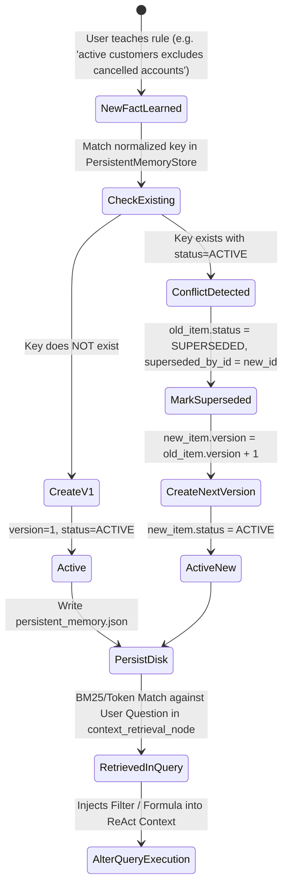

# Architecture Blueprint: Autonomous Data Analysis Agent with LangGraph

This document outlines the system architecture, component contracts, LangGraph StateGraph reasoning loops, and persistent memory pipelines for the **Autonomous Tabular Data Analysis Agent**.

---

## 1. High-Level System Architecture

```mermaid
graph TD
    User([User / Evaluator]) -->|Query / CSV Upload| UI[Web UI / CLI REPL]
    UI -->|Natural Language Question| LangGraphCore[DataAnalysisAgent LangGraph Runtime]
    
    subgraph LangGraph StateGraph Pipeline
        START([START]) --> ContextNode[1. context_retrieval_node]
        ContextNode --> PlannerNode[2. planner_node]
        
        PlannerNode -->|Conditional Edge: execute_tool| ToolNode[3. tool_executor_node]
        ToolNode -->|Feedback Loop| PlannerNode
        
        PlannerNode -->|Conditional Edge: synthesize| SynthNode[4. synthesizer_node]
        SynthNode --> END([END])
    end

    subgraph Memory & Hybrid RAG Subsystem
        ContextNode <--> HybridRetriever[Hybrid Memory & Text Retriever]
        HybridRetriever <--> MemStore[(Persistent Memory Store<br>JSON Storage)]
        HybridRetriever <--> VectorStore[(In-Memory Vector Store<br>TF-IDF + Cosine Sim)]
    end

    subgraph Analytical Tools Suite (9 Engines)
        ToolNode --> Tool1[1. DatasetProfiler]
        ToolNode --> Tool2[2. StatisticalHypothesisTester]
        ToolNode --> Tool3[3. AnomalyOutlierDetector]
        ToolNode --> Tool4[4. MultivariateDriverAnalysis]
        ToolNode --> Tool5[5. TimeSeriesTrendForecaster]
        ToolNode --> Tool6[6. SQLAndAggregationEngine]
        ToolNode --> Tool7[7. VisualizationGenerator]
        ToolNode --> Tool8[8. MemoryInspectorAndSetter]
        ToolNode --> Tool9[9. SemanticKnowledgeAndTextRetriever]
    end

    subgraph Execution & Data Layer
        Tool1 & Tool2 & Tool3 & Tool4 & Tool5 & Tool6 & Tool7 & Tool9 -->|Execute on In-Memory Data| TabularData[Universal TabularDataset<br>Pandas / DuckDB]
        Tool7 -->|Write HTML & PNG| ArtifactsDir[(data_artifacts/)]
        Tool8 -->|Save New Fact / Resolve Conflict| MemStore
        Tool9 -->|Semantic Vector Search| VectorStore
    end

    SynthNode -->|Return Structured AgentResponse| UI
```

---

## 2. LangGraph StateGraph Architecture

The agent execution pipeline is formally modeled and compiled as a **LangGraph `StateGraph(AgentGraphState)`**:

### 2.1 State Schema (`AgentGraphState`)
```python
class AgentGraphState(TypedDict):
    query: str                                # User's original natural language prompt
    messages: List[Dict[str, Any]]            # Conversation history with system prompt
    dataset_schema: Dict[str, Any]            # Column dtypes, null %, cardinality
    relevant_memories: List[Dict[str, Any]]   # Retrieved business rules & filters
    thought_steps: List[Dict[str, Any]]       # Structured chain-of-thought traces
    current_thought: Optional[str]            # Latest planner thought
    current_tool: Optional[str]               # Selected tool name
    current_tool_args: Optional[Dict[str, Any]] # Tool execution arguments
    current_observation: Optional[str]        # Result returned from tool execution
    artifacts: List[str]                      # Filepaths to generated charts/figures
    final_answer: Optional[str]               # Synthesized data-backed answer
    learned_fact_note: Optional[str]          # Notification of any newly learned rules
    iteration: int                            # Loop counter (bounded by MAX_ITERATIONS)
    is_complete: bool                         # Graph termination flag
```

### 2.2 LangGraph Node Responsibilities
1. **`context_retrieval_node`**:
   - Ingests dataset schema from `TabularDataset`.
   - Parses the user prompt for newly defined business rules (`extract_and_save_heuristic_fact`).
   - Retrieves active memories using semantic and lexical keyword matching.
   - Dynamically constructs the system prompt and initializes message history.
2. **`planner_node`**:
   - Uses the LLM client (or deterministic analytical planner) to analyze the latest state.
   - Formulates the analytical hypothesis/thought.
   - Decides whether a tool call is required or if the question can be finalized.
   - Updates `iteration`, `current_thought`, `current_tool`, and `current_tool_args`.
3. **`tool_executor_node`**:
   - Dispatches the chosen tool from `ToolRegistry` against the loaded dataset.
   - Executes computation safely and captures `ToolResult`.
   - Collects generated visual artifacts (Plotly HTML / Matplotlib PNG).
   - Appends tool observations to `messages` and cycles back to `planner_node`.
4. **`synthesizer_node`**:
   - Combines the analytical findings, tool observations, memory attributions, and chart paths into a final Markdown answer.
   - Flags `is_complete = True` and transitions to `END`.

### 2.3 Conditional Router (`_route_after_planner`)
```python
def _route_after_planner(state: AgentGraphState) -> str:
    if state.get("is_complete") or state.get("iteration", 0) >= MAX_AGENT_ITERATIONS:
        return "synthesize"
    if state.get("current_tool"):
        return "execute_tool"
    return "synthesize"
```

---

## 3. Persistent Memory Lifecycle & Conflict Resolution

The memory subsystem operates across sessions via an immutable versioning state machine:



### Memory Schema (`MemoryItem`)
- `id`: Unique alphanumeric ID (e.g. `mem_20261012163907_1a6a0d`)
- `key`: Normalized slug (e.g. `active_customers`)
- `category`: `named_filter`, `metric_definition`, `domain_fact`, `user_preference`, `correction`
- `description`: Plain-English explanation
- `formal_expression`: Executable SQL/Pandas expression (e.g. `account_status != 'Cancelled'`)
- `tags`: Referenced dataset column names
- `version`: Integer version number (1, 2, 3...)
- `status`: `active`, `superseded`, `archived`
- `superseded_by_id`: Pointer to newer replacement item

---

## 4. Analytical Tools Suite Matrix

Each tool inherits from `BaseTool`, declaring a strict JSON Schema and returning a typed `ToolResult`:

| # | Tool Identifier | Engine / Library | Capability |
|---|---|---|---|
| **1** | `dataset_profiler` | Pandas, NumPy | Audits null percentages, column data types, unique cardinality, Fisher-Pearson skewness alerts, and computes an automated **Data Health Score (0–100%)**. |
| **2** | `statistical_hypothesis_tester` | SciPy (`scipy.stats`) | Performs Welch's two-sample t-test, Mann-Whitney U, One-Way ANOVA, Chi-Square independence, and correlation tests with exact two-tailed p-values and $H_0$ rejection verdicts. |
| **3** | `anomaly_and_outlier_detector` | Scikit-Learn, NumPy | Combines Tukey's 1.5x/3.0x IQR fences with Scikit-learn's **Isolation Forest** multivariate anomaly scoring. |
| **4** | `multivariate_correlator_and_driver_analysis` | Scikit-Learn, Pandas | Computes full correlation matrix, checks severe multicollinearity ($r > 0.7$), and trains Random Forest models to rank feature drivers for any target variable. |
| **5** | `temporal_trend_and_forecast_analyzer` | Pandas, NumPy | Resamples date-stamped records into consistent periods (`daily`, `weekly`, `monthly`), calculates rolling moving averages (SMA), CAGR, and fits linear trend regressions to project $k$ periods into the future. |
| **6** | `data_query_and_aggregation_engine` | DuckDB | In-memory DuckDB engine with read-only AST safety guardrails (blocking `DROP`, `DELETE`, `TRUNCATE`, `ALTER`, `INSERT`). |
| **7** | `visualizer_generator` | Plotly, Matplotlib | Generates interactive Plotly HTML charts (zoom, pan, hover) and static publication-grade Matplotlib PNG figures. |
| **8** | `memory_inspector_and_setter` | Python | Provides programmatic read, write, recall, and delete access to persistent memory directly within the agent loop. |

---

## 5. Security & Safety Guardrails

- **Read-Only SQL Sandbox**: DuckDB runs in-memory with queries inspected against forbidden modification tokens before execution.
- **Resource Capping**: SQL outputs are capped at a maximum of 100 rows per query to prevent context overflow.
- **Execution Timeouts**: LangGraph reasoning loops are bounded by `MAX_AGENT_ITERATIONS = 8` to eliminate infinite looping.
- **Graceful Offline Fallback**: If no API key is present, the deterministic analytical planner routes user intent directly into the tool suite without network calls or failures.
